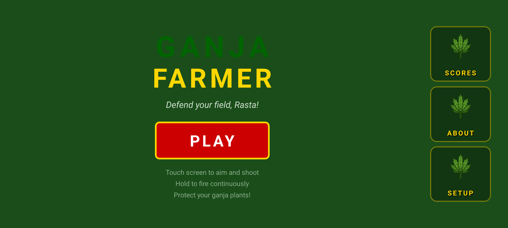
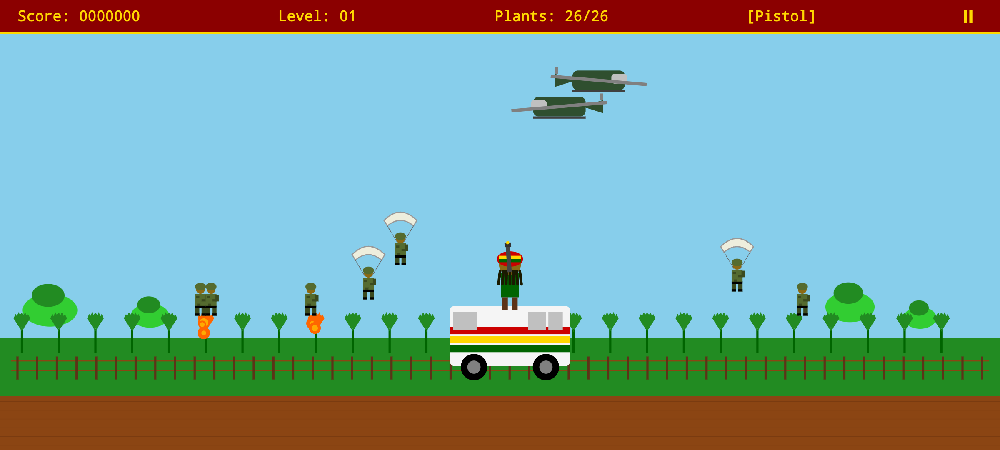
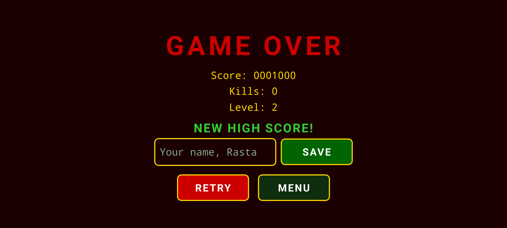

# Ganja Farmer

A landscape arcade shooter for Android, made with React Native, Expo and Skia: defend your field of 26 plants
from helicopters, paratroopers, bombers, UFOs and bosses. A tribute to the 1998 freeware *Ganja Farmer*, not
affiliated with its creators. The game is in English and intended for adults.

## Screenshots

<!-- factory:screenshots:start -->
<p>
  
  
  
</p>
<!-- factory:screenshots:end -->

## Play

Download the APK attached to the latest release (if any) or build it yourself (below), then install it on an
Android phone (allow installation from unknown sources).

## Privacy

- No account, no ads, no personal data.
- Anonymous usage statistics and crash reports (Firebase) are sent **only if you accept** on first launch.
  You can change your choice at any time in *SETUP*.
- Collected events (only after consent): game start, level completed, boss defeated, game over, game quit, settings
  changes, with numbers and short codes only (level, score, duration, cause). High-score names stay on the phone.

## Build from source

Requirements: Node.js 20+, JDK 17, Android SDK.

```bash
npm install
npm test
npm run sfx   # regenerates the synthesised sound effects in assets/sfx
```

Firebase configuration is not part of this repository. To build with telemetry, create your own Firebase project
and place its `google-services.json` in `firebase/` (see [firebase/README.md](firebase/README.md)). Without it,
the game builds and runs with telemetry disabled.

Release signing reads `FACTORY_STORE_FILE`, `FACTORY_STORE_PASSWORD`, `FACTORY_KEY_ALIAS` and
`FACTORY_KEY_PASSWORD` from your user-level `~/.gradle/gradle.properties`; without them the release build is
signed with the debug key.

## Project docs

- [Product requirements](docs/PRD.md)
- [Architecture decisions](docs/adr/)
- [Verification evidence](docs/evidence/)
