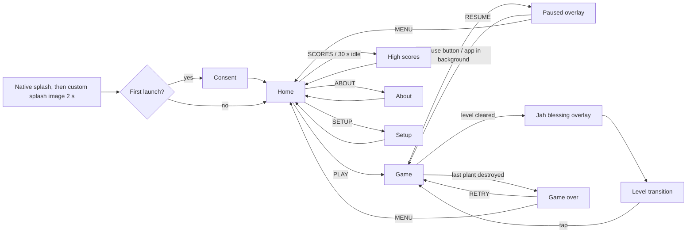

# PRD: Ganja Farmer

Status: approved
Project slug: ganja-farmer
Final app name: Ganja Farmer
Android package: io.github.nhilaire.ganjafarmer
Version target: 0.1.0
Player language: en-US (`factory-app.json` `language`)
Last updated: 2026-10-16 (with the user: AC-06/07/22 amended after verification; AC-40, AC-41 (D6), AC-42 (music) and APK size after the phone tests)

> Written in English. **Player-facing strings are in English too** (user's decision, an exception to the factory's
> French default); they are quoted in the "Player-facing copy" section.
> Status becomes `approved` only after the user explicitly approves this document.

## Summary

Ganja Farmer is a landscape arcade shooter for Android, ported into the factory from the user's existing Expo
project, which is a tribute remake of the 1998 freeware of the same name. A rasta stands on a VW van in the middle
of a row of 26 plants. Helicopters cross the sky and drop paratroopers, and once those land they walk to the plants
and burn them. The player holds a finger on the screen to aim and fire continuously. Endless levels bring stronger
weapons, new aircraft, a boss every 5 levels, falling power-ups to shoot and Jah's blessing between levels. The fun
comes from the frantic "shoot everything" pressure, combos on aircraft and the urge to beat your high score.
Pitch: "Defend your field, Rasta!"

**Reference rule:** this is a port, not a redesign. Every rule and number below comes from the source code
(`src/constants/*`, `src/engine/*`, `src/components/Game.tsx` of the source project), which wins over the source
docs whenever they differ. The port adds the factory layer (consent, opt-in telemetry, settings, sound effects,
auto-pause, tests). The only rule changes are the user-approved changes listed in "Deliberate deviations from the
source" at the end of "Rules and scoring".

## Target players

- The user and adult friends; the APK is sideloaded, there is no Play Store. The theme is for adults (cannabis,
  provocative humour).
- Two hands, phone held in landscape, couch or commute. A game lasts from 3 to 20+ minutes (endless levels), a level
  about 1-3 minutes.
- Accessibility: large touch targets on menus (>= 48 dp). Nothing else is required.

## Core loop

1. A level starts: helicopters (later Black Hawks, A-10s, crop dusters, UFOs) cross the sky.
2. Hold and drag to aim and shoot down aircraft, falling paratroopers, landed soldiers, bombs and power-up orbs.
3. Keep plants alive while you reach the level's helicopter quota and clear the sky (or kill the boss every 5
   levels).
4. Level bonus, then Jah restores some plants, then the next level with a better weapon and tougher enemies.
5. When the last plant burns, the game is over: enter your name for the top 10, then try again.

What makes one more round tempting: the next weapon unlock, the next boss, and the top-10 table on the home screen.

## Use cases

| ID | As a player I want to... | So that... |
|---|---|---|
| UC-01 | choose whether to share anonymous statistics at first launch | my privacy choice is respected |
| UC-02 | start a game from the home screen | I play right away |
| UC-03 | aim and fire continuously with one finger | I can defend the field |
| UC-04 | clear levels, unlock weapons, fight bosses, catch power-ups | the game keeps getting richer |
| UC-05 | see Jah restore plants and a quote between levels | I get a breather and a reward |
| UC-06 | pause, or have the game pause itself when I leave the app | I never lose a game to a phone call |
| UC-07 | enter my name when I make the top 10 and see the table | I can compete with friends on the same phone |
| UC-08 | turn sound, vibration and statistics on/off, reset the high scores | the game fits my preferences |
| UC-09 | read why this game exists | I know the story behind the tribute |

## Screens

- **Splash:** the native splash (black background) is followed by the source landscape splash image
  (`splash-icon.png`, "GANJA FARMER" logo) shown for 2 s, whole (letterboxed on black, never cropped).
- **Consent** (first launch only, also reachable through the STATS toggle): explains the anonymous statistics,
  with two buttons of equal size and prominence (accept / refuse). The game is fully playable either way.
- **Home:** "GANJA" / "FARMER" title, subtitle, PLAY button, the 3 control hints, and the leaf buttons SCORES
  (always shown; an empty table says "No scores yet, Rasta!"), ABOUT and SETUP. After 30 s without a touch, and if
  at least one high score exists, the high-score table is shown.
  A tap on it, or 30 s, brings back the home screen.
- **High scores:** top 10 with columns #, NAME, SCORE, LVL, KILLS. The first row is highlighted. "Tap to go back".
- **Game:** a Skia canvas with code-drawn graphics: sky, plants, van and rasta, enemies, bullets, explosions,
  power-up orbs. HUD on top: `Score: 0000000`, `Level: 01`, `Plants: n/26`, `[weapon name]`, and the active
  timed effects with their remaining seconds. Pause button. Transient messages: power-up name and description
  (2.5 s), boss name with "BOSS INCOMING" (3 s), "Rasta rocket mon !" at the start of level 10 (3 s), and the
  combo "x{n} COMBO!" with the multiplier "x{m}" (n = comboCount >= 2, m = multiplier with 1 decimal; pulsing,
  gold).
- **Paused overlay:** "PAUSED", RESUME, MENU. While paused the simulation is frozen.
- **Jah blessing overlay** (only when at least one plant is dead at the end of a level): Jah comes down on a
  cloud, golden halo, "+N Plants Restored", then goes back up (about 4 s). Touch is ignored meanwhile.
- **Level transition:** black background, "LEVEL N" for the next level, "+B pts" level bonus,
  "+N Plants Restored" (only when N > 0 for this level), a random quote from the source list,
  "New Weapon: <name>!" when a weapon unlocks, "Tap to continue" (taps are accepted after the 500 ms fade-in).
- **Game over:** "GAME OVER", then `Score: 0000000`, `Kills: n`, `Level: n`. The buttons appear after 3 s.
  On a top-10 score: "NEW HIGH SCORE!", a name field (max 12 characters) and SAVE, then "Score saved!".
  RETRY and MENU.
- **Setup:** toggles for SOUND, MUSIC, VIBRATION and STATS, plus a RESET HIGH SCORES button with a confirmation dialog.
  BACK.
- **About:** "The Original Game" (source text), "Why this game" (the story from the brief), "This Version"
  (tribute, not affiliated, made by a passionate independent developer), "Built with" (React Native, Expo, Skia),
  the app version, the Bob Marley quote, BACK.

## Rules and scoring

All distances are logical pixels of the landscape screen (W x H, W > H). `L` is the current level (1, 2, ...).
"Air enemies" are helicopter, Black Hawk, A-10, crop duster, UFO and boss. The game logic is a pure TypeScript
engine stepped with `dt` (seconds) and an injectable random source, so it can be unit-tested deterministically.

### Field and layout

- 26 plants, evenly spaced: `x_i = 20 + i * (W - 40) / 26`. The ground line is at `GROUND_Y = 0.75 H`.
- The player fires from `(PLAYER_X, PLAYER_Y - 20)`, where `PLAYER_X = 0.45 W + 0.06 W` (centre of the van) and
  `PLAYER_Y = 0.68 H - 10`.
- A game starts at level 1 with 26 live plants, score 0, kills 0 and the pistol.

### Controls and firing

- Touch down: aim angle = angle from the player to the finger, firing on. Move: re-aim. Release: firing off.
- Several fingers: firing stays on while at least one finger is down; the aim follows the last finger placed that is
  still down (lifting it falls back to the previous one). Firing stops only when the last finger is lifted
  (amended after the first phone test; the source stopped firing as soon as any finger was lifted).
- While firing, one shot every `1 / fireRate` s. Each bullet's angle = aim + uniform(-spread/2, +spread/2).
- Bullets are not slowed by Holy Smoke or Bullet Time. They are removed 20 px outside the screen.
- A non-penetrating bullet stops at its first hit. A penetrating one (laser) goes through air enemies and
  paratroopers, but a power-up orb or a bomb always stops any bullet. A bullet hits at most one target of each
  kind per frame (air enemy, paratrooper, power-up, bomb), checked in that order.
- Explosive bullets (rocket) spawn an explosion **visual** of radius 50 where they hit an air enemy (only there).
  As in the source, the explosion deals no area damage.

### Weapons (best unlocked weapon is used automatically)

| Weapon (display name) | Unlock level | Damage | Fire rate (shots/s) | Bullet speed (px/s) | Spread (rad) | Special |
|---|---|---|---|---|---|---|
| Pistol | 1 | 1 | 3.5 | 700 | 0 | - |
| Machine Gun | 4 | 1 | 8 | 800 | 0.05 | - |
| 20mm AA Gun | 7 | 3 | 5 | 900 | 0.02 | - |
| Rocket Launcher | 10 | 8 | 3.5 | 600 | 0.03 | explosive (visual, radius 50) |
| Gatling | 14 | 2 | 15 | 1000 | 0.08 | - |
| Laser Cannon | 18 | 5 | 6 | 1500 | 0 | penetrating |

### Enemies

Level multipliers: `speedMult = 1 + 0.10 (L - 1)`, `hpMult = 1 + 0.05 (L - 1)`, and spawned HP is
`ceil(baseHp * hpMult)`. The speed multiplier applies to aircraft. Paratroopers and bombs have fixed speeds.

| Enemy | Base HP | Base speed (px/s) | Score | Size | First level |
|---|---|---|---|---|---|
| Helicopter | 12 | 60 | 500 | 80x40 | 1 |
| Black Hawk | 20 | 80 | 750 | 90x45 | 5 (scripted wave and respawns) |
| Paratrooper / soldier | 2 | fall 40, walk 30, flee 50 | 100 | 24x36 | 1 |
| A-10 | 8 | 90 | 750 | 70x25 | 8 |
| Bomb | 1 | fall 120 | 300 | 10x16 | 8 |
| Crop duster | 6 | 45 | 600 | 60x22 | 12 |
| UFO | 15 | 50 | 2000 | 45x22 | 16 |

- **Helicopter / Black Hawk:**
  - **Spawn:** enters from a random side at height `HUD + uniform(20, 0.25 H)`. Its paratrooper capacity is
    randint(3, 8) for a helicopter and randint(5, 10) for a Black Hawk.
  - **Dropping:** while its centre is between 0.15 W and 0.85 W, it drops 1 paratrooper every 0.8 s, at
    `x + uniform(-20, 20)` just under its body. A drop needs capacity left, the pass limit not reached, and fewer
    than `min(6 + L, 15)` paratroopers alive in total. The pass limit is randint(1, 5), drawn again at every pass.
  - **Wrap:** it never leaves. Once it is 50 px past the edge, it reappears 10 px outside the other edge, keeping
    its HP. Then `passCount += 1`. With a 50% chance, `speed = max(0.85 speed, 30)` (only if speed > 30), and the
    new speed **does** change its movement (deviation D3). If its capacity was emptied, it reloads
    `max(ceil(maxCapacity * max(0.40 - 0.10 passCount, 0)), 1)` paratroopers.
  - **Destroyed:** paratroopers still aboard are lost; those already dropped carry on.
- **Paratrooper:**
  - **Fall:** falls at 40 px/s with a constant horizontal drift `vx = uniform(-7.5, 7.5)` px/s. On reaching
    `GROUND_Y - 36` it lands and targets the nearest live plant, by horizontal distance.
  - **On the ground:** it walks at 30 px/s and is at the plant within 5 px. There, it sets the plant on fire if
    the plant is not already burning; if the plant is shielded, it consumes the shield and gives up its target.
    A soldier without a target flees.
  - **Leaving:** after its 3rd destroyed plant, or when no live plant remains, it flees at 50 px/s to the nearest
    edge and disappears. When its target dies, it retargets the nearest live plant.
  - It can be shot in the air and on the ground (same HP, 100 points).
- **Burning plant:** `burnProgress += dt / 3` (3 s; scaled by time effects). At 1 the plant is destroyed and the
  soldier targeting it is credited.
- **A-10:** enters at height `HUD + uniform(10, 0.15 H)` and crosses, then comes back until destroyed (D6). Between 0.10 W and 0.90 W it drops
  randint(1, 2) bombs, one every 0.4 s, at `x + uniform(-15, 15)`.
- **Bomb:** falls at 120 px/s and can be shot (1 hit, 300 points). On reaching `GROUND_Y` it explodes and destroys
  every live plant within 50 px horizontally. A shielded plant loses its shield instead.
- **Crop duster:** flies low (`GROUND_Y - uniform(40, 80)`) and crosses, then comes back until destroyed (D6).
  - **Attack:** checked every frame, and only while its height is below `GROUND_Y - 60` (`y > GROUND_Y - 60`): one
    spawned higher never attacks. It sets on fire every non-burning live plant within 20 px horizontally, up to 5
    attacks per pass.
  - **Shield:** a shielded plant loses its shield instead, and that costs one of the 5 attacks. The plant is then
    immune to this crop duster for the rest of its pass (deviation D4).
- **UFO:** enters at height `HUD + uniform(20, 0.30 H)`, wobbles vertically (`vy = 30 sin(t / 0.3 s)`) and crosses
  once. After passing mid-screen it destroys one random live plant instantly every 3 s, or consumes that plant's
  shield.

### Levels and spawning

- **Quota:** `requiredHeliKills = min(3 + floor(1.5 L), 25)`. Helicopters and Black Hawks count, whether they
  are shot or destroyed by Jah Lightning.
- **Helicopters on screen:** at most `maxHelisOnScreen = 4 + (number of weapons unlocked after the pistol at
  level L)`.
- **Respawn:** while the quota is not reached, keep `min(1 + floor(L / 3), maxHelisOnScreen)` helicopters active.
  One respawns every `max(3000 - 100 L, 800)` ms; from level 5 it is a Black Hawk with probability 0.5.
- **Scripted waves** (delay from level start; the first spawn of a wave is immediate, then one per interval).
  - **Helicopter blocking:** helicopter and Black Hawk spawns of a wave wait while the helicopters + Black Hawks
    on screen are `>= maxHelisOnScreen`, and their interval timer does not advance meanwhile.
  - **Other waves:** A-10, crop duster and UFO waves are never blocked.
  - **Time scaling:** spawning timers are scaled by Holy Smoke and Bullet Time.

  | Wave | From level | Delay | Type | Count | Interval (ms) |
  |---|---|---|---|---|---|
  | 1 | 1 | 1 s | Black Hawk if `L >= 5` and L even, else helicopter | `min(2 + floor(L / 2), 6)` | `max(2500 - 100 L, 800)` |
  | 2 | 5 | 6 s | Black Hawk | `min(1 + floor(L / 2), 5)` | 3500 |
  | 3 | 8 | 10 s | A-10 | `min(1 + floor((L - 8) / 2), 5)` | `max(3500 - 100 L, 1500)` |
  | 4 | 12 | 15 s | crop duster | `min(1 + floor((L - 12) / 2), 4)` | 4000 |
  | 5 | 16 | 18 s | UFO | `min(1 + floor((L - 16) / 3), 4)` | 5000 |

- **Level complete (normal level):** the quota is reached **and** no air enemy, paratrooper or bomb is left. After
  1.5 s (bullets and explosions keep fading), the transition starts.
- **Boss level** (`L % 5 == 0`): when the quota is reached, the boss spawns. The level is complete when the boss
  has spawned and no enemy is left.
- **At level completion:**
  - Plants still burning stop burning (`burnProgress` back to 0) and count as alive for the Jah draw and at the
    next level.
  - The combo is reset at every level start.
  - Bullets and explosions keep moving during the 1.5 s delay, but plants and enemies are no longer updated.
- **Level 10 message:** at the start of level 10, the message "Rasta rocket mon !" is shown for 3 s.

### Bosses (tier `t = floor(L / 5)`)

| Tier | Level | Name | HP | Speed | Score |
|---|---|---|---|---|---|
| 1 | 5 | GENERAL SHERMAN | 120 | 30 | 7500 |
| 2 | 10 | DEA DRONE MOTHER | 250 | 35 | 10000 |
| 3 | 15 | AIR FORCE ONE | 450 | 40 | 12500 |
| 4 | 20 | MOTHERSHIP | 700 | 45 | 15000 |
| t >= 5 | 25, 30... | WARLORD MK<t> | 700 + 300 (t - 4) | 25 + 5t | 5000 + 2500t |

- **Shape and spawn:** size `(130 + 10t) x (65 + 5t)`, capacity `3 + 2t` paratroopers. The boss enters at the top
  (`HUD + 30`) from a random side and oscillates slightly vertically. Its HP is not scaled by `hpMult`.
- **Wrap:** it wraps like a helicopter, keeping its HP and redrawing its pass limit, with the same speed decay
  (D3). It never reloads paratroopers.
- **Attacks:** while between 0.10 W and 0.90 W, every 2.0 s it drops a bomb at `x + uniform(-30, 30)`. It also
  drops a paratrooper at `x + uniform(-40, 40)` if it has capacity left and its pass limit is not reached.
- **Defeat:** the boss counts as defeated whether a bullet or Jah Lightning destroys it (deviation D2): boss
  vibration, `boss_defeated` event, and the full boss score.
- **Display:** a "BOSS INCOMING" message with its name is shown for 3 s. A health bar is drawn above it.

### Scoring

- **Kills:** each kill adds the enemy's score (table above; boss per tier) and increments kills.
- **Combo** (air enemies killed by bullets): each such kill sets `comboCount += 1` and resets a 2.0 s window; if
  the window expires, the combo resets. `multiplier = 1 + 0.5 (comboCount - 1)` and the points added are
  `floor(score * multiplier)`. Paratroopers, bombs and Jah Lightning kills are not multiplied and do not count in
  the combo. "COMBO xN" is shown from 2.
- **Level bonus:** when a level completes, `L * 1000` points.

### Jah blessing (between levels)

- **Draw:** with `lossRatio = 1 - alive / 26` and `s = 0.8 lossRatio`, draw `count` in 2..10 with weights:
  - +2: `max(0.30 - 0.35 s, 0.02)`
  - +3: `max(0.25 - 0.25 s, 0.03)`
  - +4: `max(0.15 - 0.10 s, 0.03)`
  - +5: `0.10 + 0.05 s`
  - +6: `0.08 + 0.10 s`
  - +7: `0.05 + 0.15 s`
  - +8: `0.04 + 0.18 s`
  - +9: `0.02 + 0.12 s`
  - +10: `0.01 + 0.10 s`
- **Restore:** `min(count, dead)` random dead plants come back. If no plant is dead, nothing is drawn, the blessing
  overlay is skipped and the transition starts directly.

### Power-ups

- **Spawn:** 2 per level. The 1st comes at `t1 = uniform(20, 40)` s after the level start, the 2nd at
  `t1 + uniform(90, 120)` s. These timers run in real time (not slowed by Holy Smoke or Bullet Time) and stop once
  the level is complete. The type is drawn uniformly among the 12 below.
- **Orb:** it appears at `x = uniform(0.15 W, 0.85 W)` at the top, falls at 35 px/s and vanishes at the ground.
  1 hit activates it and shows its name and description for 2.5 s.
- **Effect lifetime:** timed effects end at the next level start. Plant shields, Babylon Trap charges and the
  Zion Wall carry over to the next levels until used (deviation D5); they are cleared only at a new game. Picking
  a timed effect that is already active restarts its timer. Picking a Babylon Trap or Zion Wall again resets it to
  3. Picking Ganja Shield shields every currently live plant.

| Power-up | Effect | Duration |
|---|---|---|
| RASTA POWER | bullet damage x2 | 15 s |
| SPEED SPLIFF | fire rate x2 | 15 s |
| HOLY SMOKE | enemies, spawning and burning at 0.5 speed | 10 s |
| JAH LIGHTNING | destroys every air enemy (full score, counts for the quota), paratrooper and bomb (no bomb score) | instant |
| GANJA SHIELD | every live plant gets a shield absorbing 1 attack | until used |
| BULLET TIME | enemies, spawning and burning at 0.25 speed (wins over Holy Smoke) | 8 s |
| SPREAD SHOT | 2 extra bullets at aim ± 0.15 rad | 12 s |
| ROOTS OF ZION | restores 1 random dead plant every 3 s | 15 s |
| BABYLON TRAP | the next 3 soldiers reaching a plant explode (100 points each) | 3 charges |
| ZION WALL | wall at 0.55 H stops falling paratroopers (100 points each) and bombs (no score), 3 impacts | 3 impacts |
| ONE DROP | every active air enemy and paratrooper: `hp = max(1, ceil(hp / 2))` | instant |
| DUPPY CONQUEROR | every 0.5 s, a bullet (speed 500, size 5, weapon damage) aimed at the nearest air enemy or paratrooper | 20 s |

### End of game and persistence

- **Game over:** when no plant is alive (checked every frame). Game-over vibration, then the game-over screen.
- **High scores** (local only, never sent):
  - Top 10, sorted by score, descending. An entry holds name, score, level, kills and date.
  - A score qualifies when it is > 0 and either fewer than 10 entries exist or it is strictly greater than the
    10th (a tie with the 10th does not qualify).
  - A new score equal to an existing one is placed after it (stable sort).
  - The name is trimmed and limited to 12 characters; an empty name becomes "RASTA".
- **Other local storage:** settings (sound, vibration, both on by default) and the telemetry consent. Everything
  survives an app restart; RESET HIGH SCORES (after confirmation) empties the table only.

### Pause

- **When:** the pause button, or the app leaving the foreground (Android `AppState` not `active`) during a level,
  both open the Paused overlay. The game never resumes by itself.
- **While paused:** the simulation, power-up timers, combo window and level timers are frozen.
- **MENU:** returns home; the game is abandoned and not saved.

### Hidden cheats (kept from the source)

- **Skip level:** 3 taps within 800 ms in the top-left zone (`x < 0.12 W`, `y < 0.15 H`) clear all enemies and
  complete the level after 0.5 s. The level bonus and the Jah blessing apply as usual.
- **Restore plants:** 3 taps within 800 ms in the top-right zone (`x > 0.88 W`, `y < 0.15 H`) restore 2 random
  dead plants.

### Deliberate deviations from the source (approved by the user)

- **D1 - single plant state:** the engine owns the only plant state; the UI reads it. In the source the engine and
  the store each keep their own plants and drift apart. With one state, plants restored by Roots of Zion, the
  restore cheat or Jah are immediately targetable by enemies and stay alive into the next levels. Game over is
  decided in one place.
- **D2 - boss killed by Jah Lightning:** it counts as a normal boss defeat (vibration, event).
- **D3 - helicopter speed decay applied:** the per-pass `speed` decay of helicopters, Black Hawks and bosses
  changes their actual movement. In the source it was computed but never used.
- **D4 - shield vs crop duster:** a shield blocks a crop duster for the whole pass. In the source the plant was set
  on fire on the next frame anyway.
- **D5 - lasting defences:** shields, Babylon Trap charges and Zion Wall carry over between levels until used. In
  the source they were lost at each level.
- **D6 - returning planes** (asked at the phone test): an A-10 or a crop duster that leaves the screen alive is not
  removed. It stays "away" (not drawn, not hittable, still counting as a remaining enemy, so the level cannot end)
  and comes back after `uniform(5, 10)` s, or after at most 2 s once the helicopter quota is reached. It re-enters from
  a random side at a new height (same spawn rule), keeps its HP, and starts a new pass: an A-10 reloads randint(1, 2)
  bombs, a crop duster gets its 5 attacks back (and a new D4 pass). Jah Lightning and One Drop only affect planes on
  screen. UFOs still cross once.

## Look, sound and feel

- **Orientation and screen:** landscape locked, fullscreen immersive (status and navigation bars hidden, as in
  the source plugin), dark UI style.
- **Visual style:** colourful pixel/retro style, all drawn in code with Skia, with the source palette (sky
  `#87CEEB`, grass `#228B22`, dirt `#8B4513`, HUD `#8B0000` with `#FFD700` text, rasta red/yellow/green).
- **Icon and splash:** the launcher icon, adaptive icon (foreground, background, monochrome, background colour
  `#228B22`) and splash image are copied from the source assets (AI-generated for the user, publishable).
- **Animations:** flashes on hit, explosions (0.5 s), burning plants, Jah descent, combo pulse, orb sparkles.
- **Sound effects** (new, royalty-free CC0 or generated, short OGG files):
  - shot (one sound per weapon family)
  - explosion
  - plant catching fire
  - power-up activation
  - boss incoming
  - Jah blessing
  - game over

  Rapid-fire weapons limit the shot sound to at most 10 plays/s. SOUND off mutes every sound effect. Sounds play
  on the media stream, also when the phone ringer is on silent or vibrate (found at the phone test).
- **Background music** (added at the phone test): "Rasta Rocket Man" (`assets/music/rasta-rocket-man.mp3`, made by
  the author for this game), looped on every screen at volume 0.25, below the sound effects. It pauses when the app
  leaves the foreground and resumes when it comes back. MUSIC in SETUP (on by default, saved) turns it on or off
  independently of SOUND.
- **Haptics:** 30 ms when a plant catches fire; pattern `[0, 50, 30, 50, 30, 100]` when a boss is defeated;
  pattern `[0, 100, 50, 200]` at game over. VIBRATION off disables them all.

## Telemetry events

Only events listed here may be sent, and only after consent. Params are numbers or short lowercase enums. No
identifiers, no free text, high-score names are never sent.

| Event | When | Params | Feeds KPI |
|---|---|---|---|
| game_start | PLAY or RETRY starts a game | level (=1) | Games per session, D1/D7 retention |
| level_complete | a level is completed (before the bonus is added) | level, score, duration_s, plants_alive | Level funnel |
| boss_defeated | a boss is destroyed (by a bullet or by Jah Lightning) | level | Level funnel |
| game_over | the last plant is destroyed | level, score, duration_s, cause (`soldier`, `bomb`, `cropduster`, `ufo`) | Drop-off by level, game-over cause, game duration |
| game_quit | MENU from the Paused overlay | level, duration_s | Drop-off by level, game duration |
| settings_change | a SETUP toggle changes or the scores are reset | setting (`sound`, `music`, `vibration`, `telemetry`, `reset_scores`), value (`on`, `off`, `done`) | Settings usage |

- `duration_s`: active play time of the whole game (pauses excluded), rounded to seconds.
- `cause`: what destroyed the last plant. A soldier's fire and a crop duster's fire are told apart by who set the
  plant on fire.
- When STATS is turned off, `settings_change` for `telemetry` `off` is the last event sent, and nothing is sent
  after it.

## KPIs

Business and technical indicators followed in Firebase (free Spark plan). Details and console paths are in
`docs/KPIS.md`.

| KPI | Type | Target | Source |
|---|---|---|---|
| D1 retention | business | >= 30% | Analytics > Retention |
| D7 retention | business | >= 10% | Analytics > Retention |
| Games per session | business | >= 2 | `game_start` count / `session_start` count |
| Games per active user per day | business | >= 3 | `game_start` count / DAU |
| Average game duration | business | >= 4 min | `game_over` + `game_quit` `duration_s` |
| Average engagement time per session | business | >= 8 min | Analytics > Engagement overview (automatic) |
| Level funnel / drop-off | business | median game-over level >= 5 | `level_complete` and `game_over` by `level` |
| Game-over cause distribution | business | no single cause > 70% | `game_over` by `cause` |
| Crash-free users | technical | >= 99% | Crashlytics |
| ANR rate | technical | < 0.5% | Crashlytics (ANR filter) |

## Non-functional requirements

- Performance: no visible jank during play on a mid-range Android phone (target 60 fps with 4 helicopters,
  15 paratroopers and active effects); cold start < 3 s (time to the first frame, measured by `verify.mjs`).
- APK size (arm64): target < 60 MB (amended with the user after the first phone test: 54 MB with Skia and
  Reanimated; the initial 40 MB target did not account for them).
- Works fully offline. No account. No ads. No backend.
- Android: minSdk from the stack defaults; **landscape only**.
- Privacy: opt-in telemetry, no personal data, AD_ID permission removed, high-score names stay on the phone.
- Game logic is pure TypeScript with no React Native imports: the engine, level/enemy/weapon/power-up constants,
  scoring, Jah draw and high-score rules are covered by Jest unit tests with a seeded random source.

## Acceptance criteria

Each criterion is testable and tagged with its proof: `[unit]` Jest, `[e2e]` Maestro flow, `[device]` check on the
phone, `[manual]` human judgement (kept rare).

- AC-01 [e2e] Given a first launch, when the splash ends, then the consent screen is shown in English with an
  accept and a refuse button of equal size.
- AC-02 [e2e] Given the consent screen, when the player accepts or refuses, then the home screen is shown, and on
  the next launch the consent screen is not shown again.
- AC-03 [unit] Given telemetry refused (or STATS off), when any game event occurs, then nothing is passed to
  Firebase; given consent, the events and params of the "Telemetry events" table are sent and only them.
- AC-04 [unit] Given any telemetry event, when it is built, then its params are only numbers and the listed enums
  (no name, no free text).
- AC-05 [device] Given consent was accepted, when a scripted game runs on the emulator, then `game_start`,
  `level_complete` and `game_over` appear in logcat (`Logging event`).
- AC-06 [e2e] Given a cold launch, when the app starts, then the whole splash image with the "GANJA FARMER"
  logo (not cropped, black bars if needed) is shown for about 2 s, in landscape and fullscreen, then the next screen
  appears.
- AC-07 [e2e] Given the home screen, then it shows the GANJA FARMER title, "Defend your field, Rasta!", PLAY, the
  3 control hints, SCORES (even before any score), ABOUT and SETUP.
- AC-08 [e2e] Given the home screen, when PLAY is tapped, then the game screen shows the HUD
  (`Score: 0000000`, `Level: 01`, `Plants: 26/26`, `[Pistol]`) and a pause button.
- AC-09 [unit] Given firing is on with aim angle a, when time advances, then bullets are created at the weapon's
  fire rate (x2 with Speed Spliff) along a ± spread/2 from the player position, and none when firing is off.
- AC-10 [unit] Given a level L, then the weapon is the last unlocked in the weapons table (L=1 Pistol, 4 Machine
  Gun, 7 20mm AA Gun, 10 Rocket Launcher, 14 Gatling, 18 Laser Cannon) with the listed stats.
- AC-11 [unit] Given a level L, then quota, speed/HP multipliers, max helicopters on screen, active-helicopter
  target, respawn interval and scripted waves match the formulas of "Levels and spawning" (checked for
  L = 1, 4, 5, 8, 12, 16, 20, 30). Helicopter spawns of a wave wait (timer frozen) at `maxHelisOnScreen` while
  A-10, crop duster and UFO waves do not.
- AC-12 [unit] Given a helicopter or Black Hawk, then capacity ranges, dropping (zone, 0.8 s, offset ± 20, pass
  limit 1-5, global cap `min(6 + L, 15)`), wrapping (HP kept, passCount, reload formula) match the rules, and a
  speed decay on wrap reduces its actual horizontal velocity (D3).
- AC-13 [unit] Given a paratrooper, then it falls at 40 px/s with a drift within ± 7.5 px/s, lands, walks at
  30 px/s to the nearest live plant, sets it on fire, the plant dies after 3 s, and the soldier flees after 3
  destroyed plants or when no plant is left.
- AC-14 [unit] Given an A-10, a bomb, a crop duster and a UFO, then their bombing, blast radius (50 px), low-pass
  fire (20 px, max 5, only when `y > GROUND_Y - 60`) and abduction (every 3 s after mid-screen) match the rules.
  A shield absorbs a soldier, a bomb or a UFO attack, and protects its plant from a crop duster for that whole
  pass (D4).
- AC-38 [unit] Given a plant restored by Roots of Zion, the restore cheat or Jah, then soldiers can target it at
  once, and when the next level starts it is still alive (D1).
- AC-39 [unit] Given a laser bullet, then it goes through air enemies and paratroopers but is stopped by a
  power-up orb or a bomb.
- AC-40 [unit] Given one finger held down while firing, when a second finger touches the screen and the first one is
  lifted, then firing continues and aims at the second finger; firing stops only when no finger is left.
- AC-41 [unit] Given an A-10 or a crop duster that leaves the screen alive, then it is not drawn nor hittable while
  away, the level does not complete, and it comes back after 5-10 s (at most 2 s once the quota is reached) from a
  random side with the same HP and a new pass (A-10: 1-2 new bombs; crop duster: 5 new attacks) (D6).
- AC-42 [unit] Given MUSIC on (default), then the background music loops at volume 0.25 from app start; it pauses
  when the app leaves the foreground and resumes on return; MUSIC off stops it and the choice survives a restart;
  SOUND off does not stop the music.
- AC-15 [unit] Given kills, then each enemy adds its score, air kills by bullets within 2.0 s build a combo with
  multiplier `1 + 0.5 (n - 1)` and `floor` rounding, and paratroopers, bombs and Jah Lightning kills are not
  multiplied.
- AC-16 [unit] Given a normal level, when the quota is reached and no enemy is left, then the level completes
  after 1.5 s and `L * 1000` is added; it does not complete while any air enemy, paratrooper or bomb remains.
  Plants still burning at completion are alive and no longer burning at the next level, and the combo is reset.
- AC-17 [unit] Given the end of a level with d dead plants (burning plants count as alive), then the Jah draw uses
  the weighted table (2..10) and restores `min(count, d)` plants; with d = 0 the blessing is skipped.
- AC-18 [unit] Given a boss level (L % 5 == 0), when the quota is reached, then the boss spawns with the tier's
  name, HP, speed, score and capacity, drops a bomb (and a paratrooper if able) every 2.0 s, wraps without
  reloading, and the level completes only once it is destroyed and no enemy is left. A boss destroyed by Jah
  Lightning fires the boss-defeated callback like a bullet kill (D2).
- AC-19 [unit] Given a level, then the 1st power-up spawns at `t1 = uniform(20, 40)` s and the 2nd at
  `t1 + uniform(90, 120)` s (real time, unaffected by time effects); they fall at 35 px/s, vanish at the ground,
  and 1 hit activates them.
- AC-20 [unit] Given each of the 12 power-ups, when activated, then its effect and duration match the power-up
  table (including Bullet Time winning over Holy Smoke and timer refresh). Timed effects are cleared at level
  start, while shields, trap charges and wall carry over to the next level until used (D5).
- AC-21 [unit] Given a game, when the last live plant is destroyed, then the game-over callback fires exactly once.
- AC-22 [e2e] Given a game with all 26 plants alive, when the skip-level cheat is used, then the level
  transition screen shows "LEVEL 2", the bonus "+1000 pts", a quote and "Tap to continue", and no
  "Plants Restored" line. A tap returns to the game at level 2.
- AC-23 [e2e] Given a game lost with a qualifying score, when the game-over screen appears, then it shows score,
  kills and level, "NEW HIGH SCORE!" and a name field. After SAVE, "Score saved!" is shown and the entry appears in
  the SCORES table on the home screen.
- AC-24 [unit] Given high scores, then the table keeps the top 10 sorted by score. A tie with the 10th does not
  qualify, and an equal new score goes after the existing one. Names are trimmed to 12 characters and an empty
  name becomes "RASTA".
- AC-25 [e2e] Given a saved high score, when the app is killed and relaunched, then the SCORES table still shows it.
- AC-26 [e2e] Given a game in progress, when the pause button is tapped, then "PAUSED" with RESUME and MENU is
  shown. RESUME returns to the game and MENU to the home screen.
- AC-27 [e2e] Given a game in progress, when the app goes to the background and comes back, then the Paused
  overlay is shown and the game has not advanced.
- AC-28 [unit] Given the pause state, when time advances, then no entity, timer, combo window or power-up spawn
  timer changes.
- AC-29 [e2e] Given SETUP, then it shows SOUND, MUSIC, VIBRATION and STATS toggles and RESET HIGH SCORES. Changed toggles
  survive an app restart. RESET HIGH SCORES asks for confirmation and then empties the SCORES table.
- AC-30 [unit] Given SOUND off, then no sound effect is played; given VIBRATION off, then no vibration is
  requested; both are on by default.
- AC-31 [unit] Given the triple-tap cheat zones, when 3 taps happen within 800 ms in the top-left (or top-right)
  zone, then the level completes (or 2 dead plants are restored); 3 taps spread over more than 800 ms do nothing.
- AC-32 [e2e] Given the home screen, when ABOUT is tapped, then it shows the "Why this game" story text from this
  PRD, "passionate independent developer" and the app version.
- AC-33 [e2e] Given the home screen with at least one high score, when nothing is touched for 30 s, then the
  high-score table is shown, and a tap returns to the home screen.
- AC-34 [device] Given the release APK installed, then the launcher shows the source icon and the name
  "Ganja Farmer", and the app runs in landscape fullscreen.
- AC-35 [device] Given the release build on the emulator, when the cold start is measured, then it is < 3 s.
- AC-36 [device] Given the Maestro flows run on the release build, then logcat shows no crash and no ANR for the
  app.
- AC-37 [manual] Given the APK on the user's phone, when the user plays a few levels, then the game feels like the
  source game (same pace, weapons, enemies, Jah, bosses), sound effects fit and play is smooth.

## Player-facing copy

English, casual tone with rasta winks. Kept from the source unless marked new. All strings live in the i18n module.

| Key | English text |
|---|---|
| home.title | GANJA / FARMER |
| home.subtitle | Defend your field, Rasta! |
| home.play | PLAY |
| home.hint1 | Touch screen to aim and shoot |
| home.hint2 | Hold to fire continuously |
| home.hint3 | Protect your ganja plants! |
| home.scores / home.about / home.setup | SCORES / ABOUT / SETUP |
| scores.title | HIGH SCORES |
| scores.columns | # / NAME / SCORE / LVL / KILLS |
| scores.back | Tap to go back |
| hud.score / hud.level / hud.plants | Score: {score7} / Level: {level2} / Plants: {alive}/26 |
| pause.title / pause.resume / pause.menu | PAUSED / RESUME / MENU |
| game.bossIncoming | BOSS INCOMING: {name} |
| game.combo | x{n} COMBO! (and x{multiplier, 1 decimal}) |
| game.rocketMessage | Rasta rocket mon ! |
| blessing.restored | +{n} Plants Restored |
| transition.level | LEVEL {n} |
| transition.bonus | +{bonus} pts |
| transition.newWeapon | New Weapon: {weapon}! |
| transition.continue | Tap to continue |
| gameover.title | GAME OVER |
| gameover.stats | Score: {score7} / Kills: {kills} / Level: {level} |
| gameover.newRecord | NEW HIGH SCORE! |
| gameover.namePlaceholder | Your name, Rasta (new) |
| gameover.save / gameover.saved | SAVE / Score saved! |
| gameover.retry / gameover.menu | RETRY / MENU |
| consent.title | Help the farm grow? (new) |
| consent.body | Share anonymous game statistics (levels reached, game length, crashes) to help improve Ganja Farmer. No name, no ID, no ads. You can change this anytime in SETUP. (new) |
| consent.accept / consent.refuse | YES, SHARE STATS / NO THANKS (new) |
| setup.title | SETUP |
| setup.sound / setup.music / setup.vibration / setup.stats | SOUND / MUSIC / VIBRATION / STATS (new) |
| setup.on / setup.off | ON / OFF (new) |
| setup.reset | RESET HIGH SCORES (new) |
| setup.resetConfirm | Erase all high scores, Rasta? (new) |
| setup.resetYes / setup.resetNo | ERASE / CANCEL (new) |
| common.back | BACK |
| about.title | ABOUT |
| about.original | The Original Game (source text, 3 paragraphs) |
| about.whyTitle | Why this game (new) |
| about.story | I played Ganja Farmer for hours as a teenager, on the family computer, found in a folder of downloaded freeware games. I made this version to bring it back on my phone - a tribute by a passionate independent developer, not affiliated with the original creators. |
| about.version | Version {version} (new) |
| about.quote | "One good thing about music, when it hits you, you feel no pain." - Bob Marley |
| weapons | Pistol / Machine Gun / 20mm AA Gun / Rocket Launcher / Gatling / Laser Cannon (English names, new) |
| powerups | names and descriptions as in the power-up table of the source (`RASTA POWER` / `x2 Damage 15s`, ...) |
| quotes | the 34 Jah messages of the source level transition, unchanged |

## Out of scope

- Online leaderboard, accounts, cloud save, multiplayer.
- Web and iOS builds; Play Store publication.
- New weapons, enemies, power-ups or rule changes beyond the source code and deviations D1-D6; rebalancing.
- Rocket area damage (explosions stay visual, as in the source).
- Boss shield phases (defined in the source constants but unused by its engine).
- Resuming an abandoned game after leaving to the menu or killing the app.
- Ads, in-app purchases, backend.

## Open questions

None
